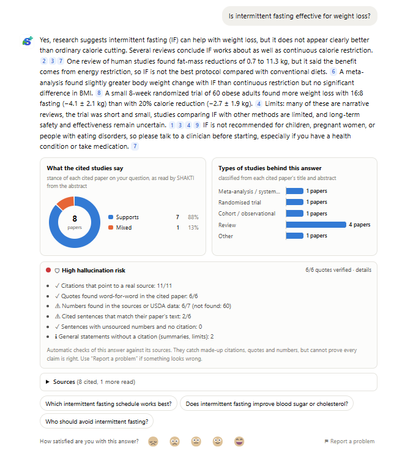
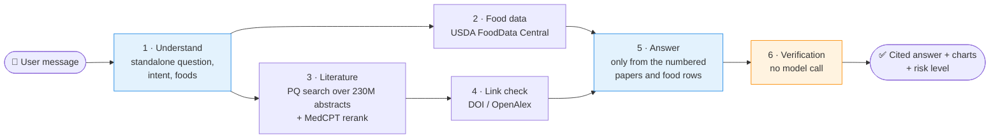

<div align="center">

# 🥗 SHAKTI

### Evidence-Grounded Conversational AI for Nutrition and Health

**S**mart **H**ealth **A**dvisor for **K**nowledge-based **T**ailored **I**nterventions

Ask a nutrition, food or health question. Get a plain-language answer drawn **only** from published research and USDA food data. Every claim carries a citation, every quote is verbatim, and every answer is checked automatically for hallucinations.

[](LICENSE)


[How it works](#-how-it-works) ·
[Quick start](#-quick-start) ·
[Connect a model](#-connect-a-language-model) ·
[MCP](#-use-it-from-an-mcp-client) ·
[Tested](#-what-has-been-tested) ·
[Data](#-data-14-tb-available-on-request) ·
[Cite](#-citation)

</div>

---

## ✨ What it looks like

<div align="center">


<sub><i>A sample answer in the SHAKTI web app (<code>shakti_chat_server.py</code>). It shows numbered citations, what the cited studies say, the types of study behind the answer, the automatic hallucination check, the sources and suggested follow-up questions. This screenshot comes from a 10 Nov 2026 build. The risk thresholds were recalibrated afterwards, so the current version may label the same checks differently.</i></sub>
</div>

---

## 🌟 Highlights

| | |
|---|---|
| 📚 **The whole literature** | Searches the complete OpenAlex corpus: 484M works, of which 230M have abstracts. Search takes about 1 s on a single 16 GB GPU, followed by MedCPT reranking. |
| 🍎 **Exact food data** | Nutrient values come straight from USDA FoodData Central and are never estimated by the model. |
| 🔗 **Citations you can check** | Every source link is resolved before the answer is shown, and sources that no longer resolve are dropped. |
| 🛡️ **Hallucination check without a model** | Citations, verbatim quotes, numbers and semantic support are checked for every answer, and the user sees a risk level with the reasons. |
| 💬 **Conversation-aware** | Follow-up questions are rewritten into standalone questions, using the conversation so far. |
| 🔌 **Bring your own model** | Works with the Claude Code CLI, a ChatGPT/Codex sign-in, the OpenAI API, or fully offline models (e.g. Qwen2.5-VL via Ollama, vLLM or LM Studio). |
| 🧩 **MCP server** | Use SHAKTI as a tool from Claude Desktop, Claude Code, Codex, Cursor and other MCP clients. |
| ⚙️ **One settings file** | All paths and API keys go in `shakti.env`, which is never committed. |

---

## 🧠 How it works



| # | Stage | What happens |
|---|-------|--------------|
| 1 | **Understand** | The model rewrites the message into a standalone question using the conversation, classifies it, and lists any foods that need nutrition data. |
| 2 | **Food data** | Exact values come from a local copy of USDA FoodData Central. |
| 3 | **Literature** | A product-quantised MiniLM search over about 230M abstracts runs on the GPU. A MedCPT cross-encoder reranks the results, and one of three evidence strategies is applied: single-pass, corrective (CRAG) or deep research. |
| 4 | **Link check** | Every source's DOI or OpenAlex record is resolved, and sources that no longer resolve are removed. |
| 5 | **Answer** | The model answers only from the numbered papers and food rows. It cites them as `[1]` and `[F1]`, and copies proof sentences word for word. |
| 6 | **Verification** | Every citation must point to a provided source. Every quote must occur verbatim in the cited paper. Every number must appear in the sources, the food data or the conversation, or be a sum or difference of such numbers. Every cited sentence must be semantically close to a sentence of the cited paper (MiniLM cosine ≥ 0.45). The result is a **low / medium / high** risk level, shown with its reasons. |

---

## 🚀 Quick start

> **You need:**
> - Python 3.10.
> - An NVIDIA GPU. 16 GB is enough, since the server uses about 12 GB.
> - The **113 GB serving index**. Build it yourself ([see below](#-build-everything-from-scratch)) or [request it](#-data-14-tb-available-on-request).

```bash
git clone https://github.com/Chaitanya-Pallerla/shakti-rag-nutrition.git
cd shakti-rag-nutrition

python -m venv .venv && source .venv/bin/activate        # Windows: .venv\Scripts\activate
pip install torch==2.5.1 --index-url https://download.pytorch.org/whl/cu121
pip install -r requirements.txt

cp shakti.env.example shakti.env                         # Windows: copy shakti.env.example shakti.env
#   ✏️  open shakti.env and paste your paths, model choice and keys
python shakti_config.py                                  # shows what was loaded (keys masked)

python rag_llm.py                                        # one-question smoke test of your language model
python shakti_chat_server.py --port 8780                 # 🌐 open http://127.0.0.1:8780
```

The server listens on `127.0.0.1` only. When it starts, it prints an admin link (`/admin?token=...`) to a summary of all chats.

---

## ⚙️ Your settings in one file: `shakti.env`

All folders, the model choice and any API keys live in **one file**:

1. Copy `shakti.env.example` to `shakti.env`.
2. Paste your values after the `=` signs. Leave a value empty to keep the default.
3. That's all. Every script loads the file automatically through `shakti_config.py`.

> 🔒 `shakti.env` is in `.gitignore`, so **your keys and local paths are never committed**. A variable set in your shell takes precedence over the file. To keep the file elsewhere, set `SHAKTI_ENV_FILE=/path/to/file`.

| Setting | What to paste |
|---------|---------------|
| `SHAKTI_RESEARCH_DIR` | Folder for the corpus, vectors, benchmark runs and chat logs |
| `SHAKTI_SERVE_INDEX` | Folder with the 113 GB serving index (an SSD or NVMe drive is recommended) |
| `SHAKTI_FOOD_DB` | Path to `food.duckdb` (built with `build_food_db.py`) |
| `SHAKTI_MODELS_DIR` | Folder containing `medcpt-cross-encoder/` and `specter2/` |
| `SHAKTI_LLM_BACKEND` | `claude`, `codex` or `openai` |
| `SHAKTI_LLM_MODEL` | Model name for the codex and openai backends, e.g. `qwen2.5vl:7b` |
| `SHAKTI_OPENAI_BASE_URL` | Your OpenAI-compatible server, e.g. `http://127.0.0.1:11434/v1` |
| `ANTHROPIC_API_KEY` · `OPENAI_API_KEY` · `SHAKTI_OPENAI_API_KEY` · `HF_TOKEN` | Optional. Leave them empty if you sign in to a CLI or run models locally. |

---

## 🔌 Connect a language model

All model calls go through `rag_llm.py`. Calls are stateless, use no tools, and are **cached on disk**, so a rerun never pays twice for the same call.

| Backend | Uses | Key needed? | Status |
|---------|------|-------------|--------|
| `claude` | Claude Code CLI (`claude -p`) | No: sign in with your Claude account. `ANTHROPIC_API_KEY` also works. | ✅ Used for all results in the paper |
| `codex` | OpenAI Codex CLI (`codex exec`) | No: sign in with ChatGPT. `OPENAI_API_KEY` also works. | 🧪 Experimental |
| `openai` | Any OpenAI-compatible server: OpenAI API, Ollama, vLLM, LM Studio, llama.cpp | Only for the OpenAI API or a server protected by a key | 🧪 Tested against a mock server |

The code uses three model aliases: `sonnet` for answering and grading, `opus` for the evaluation judge, and `haiku`. The `claude` backend passes them through unchanged. For the other backends, `SHAKTI_LLM_MODEL` sets the model for all of them, and `SHAKTI_LLM_MODEL_OPUS` (or `_SONNET`, `_HAIKU`) overrides one alias.

<details>
<summary><b>🟠 Claude (Claude Code CLI): the default</b></summary>

```bash
npm install -g @anthropic-ai/claude-code
claude                      # sign in once, then exit
```
```ini
SHAKTI_LLM_BACKEND=claude
```
</details>

<details>
<summary><b>🟢 ChatGPT account (OpenAI Codex CLI)</b></summary>

```bash
npm install -g @openai/codex
codex login                 # sign in with ChatGPT (or: codex login --api-key ...)
```
```ini
SHAKTI_LLM_BACKEND=codex
SHAKTI_LLM_MODEL=gpt-5
```
Codex runs read-only, in an empty folder, with the JSON schema written into the prompt.
</details>

<details>
<summary><b>🔵 OpenAI API (or another hosted OpenAI-compatible API)</b></summary>

```ini
SHAKTI_LLM_BACKEND=openai
SHAKTI_OPENAI_BASE_URL=https://api.openai.com/v1
OPENAI_API_KEY=sk-...
SHAKTI_LLM_MODEL=gpt-5
```
</details>

<details>
<summary><b>💻 Offline: Qwen2.5-VL or any local model (Ollama · vLLM · LM Studio)</b></summary>

No account and no key, and no data leaves your machine. SHAKTI sends many abstracts per question, so **give the model a context of at least 32k tokens**. Local models are also slower, so raise the timeouts.

**Ollama**
```bash
ollama pull qwen2.5vl:7b
OLLAMA_CONTEXT_LENGTH=32768 ollama serve      # Windows: set OLLAMA_CONTEXT_LENGTH=32768 then: ollama serve
```
```ini
SHAKTI_LLM_BACKEND=openai
SHAKTI_OPENAI_BASE_URL=http://127.0.0.1:11434/v1
SHAKTI_LLM_MODEL=qwen2.5vl:7b
SHAKTI_T_STEP=300
SHAKTI_T_ANSWER=600
```

**vLLM**
```bash
vllm serve Qwen/Qwen2.5-VL-7B-Instruct --max-model-len 32768
```
```ini
SHAKTI_OPENAI_BASE_URL=http://127.0.0.1:8000/v1
SHAKTI_LLM_MODEL=Qwen/Qwen2.5-VL-7B-Instruct
```

**LM Studio:** start its local server, then set `SHAKTI_OPENAI_BASE_URL=http://127.0.0.1:1234/v1` and `SHAKTI_LLM_MODEL` to the model's identifier.

**Notes on local models:**

- **GPU memory.** The chat server already uses about 12 GB of GPU memory, so a 7B model will not fit beside it on a 16 GB card. Run the model on a second GPU or another machine (point `SHAKTI_OPENAI_BASE_URL` to it), or use a small quantised model.
- **JSON output.** If your server rejects `response_format: json_schema`, SHAKTI retries automatically with the schema written into the prompt. Setting `SHAKTI_OPENAI_JSON_SCHEMA=0` skips the first attempt.
- **Answer quality.** Smaller models follow the citation and quote rules less reliably. Stage 6 still checks every answer and shows what went wrong.
</details>

Test your choice with `python rag_llm.py`, which asks one yes/no question and prints the reply.

---

## 🧩 Use it from an MCP client

`mcp_server.py` exposes SHAKTI as two MCP tools:

- `ask_shakti` returns a cited answer, the sources and the verification result.
- `ask_shakti_json` returns the full JSON result.

It is a thin client of the chat server, so **start `shakti_chat_server.py` first**. The MCP server connects to `SHAKTI_URL`, which defaults to `http://127.0.0.1:8780`.

<details>
<summary><b>Claude Code</b></summary>

```bash
claude mcp add shakti -- python /full/path/to/shakti-rag-nutrition/mcp_server.py
```
</details>

<details>
<summary><b>Claude Desktop</b> (<code>claude_desktop_config.json</code>: Settings → Developer → Edit config)</summary>

```json
{
  "mcpServers": {
    "shakti": {
      "command": "/full/path/to/.venv/bin/python",
      "args": ["/full/path/to/shakti-rag-nutrition/mcp_server.py"],
      "env": { "SHAKTI_URL": "http://127.0.0.1:8780" }
    }
  }
}
```
</details>

<details>
<summary><b>OpenAI Codex CLI</b> (<code>~/.codex/config.toml</code>)</summary>

```toml
[mcp_servers.shakti]
command = "/full/path/to/.venv/bin/python"
args = ["/full/path/to/shakti-rag-nutrition/mcp_server.py"]
```
</details>

Other MCP clients that can start a stdio server (Cursor, Windsurf, Continue and others) are set up the same way: give them the command plus the path to `mcp_server.py`. SHAKTI's own model, set by `SHAKTI_LLM_BACKEND`, still writes the answer. Your assistant then receives the cited, verified result and can discuss it with you.

---

## 🧪 What has been tested

### In the paper (all reported results)

| What | Models | Scale |
|------|--------|-------|
| Retrieval benchmark: exact search over all 484M works, hybrid fusion, reranking | all-MiniLM-L6-v2 · SPECTER2 (proximity + adhoc_query) · MedCPT cross-encoder | 10,065 questions (NFCorpus, BioASQ, SciFact, PubMedQA) |
| RAG methods: vanilla, multi-hop, CRAG, deep research | Answering: **Claude Sonnet**. Judge: **Claude Opus**. Both through the Claude Code CLI (`sonnet` / `opus` aliases), November 2026. | 1,000 questions per method (999 scored); claim-level judging on 200 per method |
| Live SHAKTI chat (stages 1–6) | Claude Sonnet answering, Claude Opus judging, the same retrieval models | 12 scripted conversations (36 turns); load test with 38 fresh questions |
| Serving index | PQ 48 × 8 over MiniLM vectors, GPU search | 229.8M papers; its top-300 contains 98.2% of the exact top-10 |

The hardware was one workstation: an Intel Core i9-13900KF, 32 GB RAM, an NVIDIA RTX 4080 (16 GB), Windows 11 and Python 3.10. Package versions are pinned in `requirements*.txt`. Every Claude response was cached, so the scoring can be replayed exactly.

The CLI aliases point to the newest Sonnet and Opus versions available at the time of the evaluation. A later run, or a run with another backend, may give different numbers.

### Checks on this public release (November 2026)

| Component | Result |
|-----------|--------|
| All Python files compile; no personal paths or keys in the code | ✅ |
| `shakti_config.py` loads `shakti.env` (relative paths resolved, keys masked when printed) | ✅ |
| `openai` backend: structured JSON, fallback when a server rejects `json_schema`, token counts, disk cache | ✅ against a mock OpenAI-compatible server |
| `build_food_db.py` on CSV files in the FoodData Central format, queried exactly as the chat server does | ✅ |
| `flatten_openalex.py` on the OpenAlex snapshot folder layout | ✅ |

### Not tested yet

- ⬜ The `codex` backend (Codex CLI / ChatGPT sign-in).
- ⬜ A real local model on the `openai` backend: Qwen2.5-VL on Ollama, vLLM or LM Studio. The OpenAI API itself is also untested.
- ⬜ `mcp_server.py` end to end with an MCP client.
- ⬜ Linux and macOS. Everything above ran on Windows.

Tried one of these? Please [open an issue](https://github.com/Chaitanya-Pallerla/shakti-rag-nutrition/issues) with your results, whether it worked or failed.

---

## 💾 Data (≈1.4 TB, available on request)

### The indexed and embedded OpenAlex corpus

The paper searches the **complete OpenAlex works snapshot: 484,368,086 works**, of which 229,801,842 have an abstract. Every work was embedded on the GPU with all-MiniLM-L6-v2 (384-d) and with SPECTER2 (768-d). Sizes are in GB (10⁹ bytes):

| Part | Folder | Size | Needed for |
|------|--------|-----:|------------|
| Paper metadata (title, abstract, year, DOI, venue, authors…) | `full/meta/*.parquet` | 132.0 GB | Everything |
| MiniLM vectors, fp16, 484M × 384 | `full/vec/*.npy` | 372.0 GB | Benchmark search; building the serving index |
| SPECTER2 vectors, fp16, 484M × 768 | `full/specter2/*.npy` | 744.0 GB | SPECTER2 / hybrid benchmark runs |
| Citation graph (references, related works, topics) | `full/graph/*.parquet` | 35.8 GB | GraphRAG / citation features |
| Abstract mask | `full/mask_abstract` | 0.5 GB | Abstract-only runs |
| ⭐ **Serving index**: PQ codes plus title and abstract text for 229.8M papers | `shakti_serve_index/` | **112.9 GB** | **The chat server and the MCP tools** |
| **Total** | | **≈1,397 GB (≈1.4 TB)** | |

> 📦 **Available on request.** The data is far too large for GitHub. Email [pallerla@uark.edu](mailto:pallerla@uark.edu) or [open an issue](https://github.com/Chaitanya-Pallerla/shakti-rag-nutrition/issues) and say which parts you need. For example, only the 113 GB serving index is needed to run the chat. Large transfers are easiest on a drive you send, or through a cloud bucket you provide. OpenAlex is released under CC0, so the derived index can be shared freely.

The data is split into 2,127 shards, one per OpenAlex snapshot file. The raw OpenAlex snapshot is not included because anyone can download it (see below).

### Models

| Model | Where | Source |
|-------|-------|--------|
| all-MiniLM-L6-v2 | Downloaded automatically into the Hugging Face cache | `sentence-transformers/all-MiniLM-L6-v2` |
| MedCPT cross-encoder | `$SHAKTI_MODELS_DIR/medcpt-cross-encoder/` | `ncbi/MedCPT-Cross-Encoder` |
| SPECTER2 (base + adapters) | `$SHAKTI_MODELS_DIR/specter2/{base,proximity,adhoc_query}/` | `allenai/specter2_base`, `allenai/specter2`, `allenai/specter2_adhoc_query` |

```bash
huggingface-cli download ncbi/MedCPT-Cross-Encoder   --local-dir models/medcpt-cross-encoder
huggingface-cli download allenai/specter2_base        --local-dir models/specter2/base
huggingface-cli download allenai/specter2             --local-dir models/specter2/proximity
huggingface-cli download allenai/specter2_adhoc_query --local-dir models/specter2/adhoc_query
```

### Food data

Download **"Full Download of All Data Types" (CSV)** from [USDA FoodData Central](https://fdc.nal.usda.gov/download-datasets), unzip it, then run:

```bash
python build_food_db.py /path/to/FoodData_Central_csv_folder      # -> food.duckdb (SHAKTI_FOOD_DB)
```

---

## 🏗️ Build everything from scratch

<details>
<summary><b>Corpus → vectors → serving index</b> (≈1.4 TB, several days of GPU time, resumable)</summary>

Every step is resumable: rerun it after any interruption and it continues where it stopped. Embedding runs on the GPU only, and the scripts never fall back to the CPU.

```bash
# 1. OpenAlex works snapshot (free, no account), flattened to the layout full_index.py reads
aws s3 sync s3://openalex/data/works ./openalex_download --no-sign-request
python flatten_openalex.py ./openalex_download            # -> $SHAKTI_RESEARCH_DIR/openalex_works/

# 2. metadata + MiniLM vectors for every work (GPU)
python full_index.py

# 3. SPECTER2 vectors (second environment: requirements-specter2.txt)
python specter2_index.py

# 4. optional: citation graph, corpus statistics, vector audit
python citation_graph.py
python corpus_stats.py
python vec_audit.py

# 5. abstract mask + compact serving index for the chat (GPU k-means, PQ 48 x 8)
python rag_mask.py
python serve_index.py build
python serve_index.py check            # recall of the PQ search against exact search
```
</details>

## 📊 Reproduce the evaluation

<details>
<summary><b>Benchmark (10,065 questions) and live-system evaluation</b></summary>

```bash
# benchmark questions + gold mapping (NFCorpus, BioASQ, SciFact, PubMedQA -> OpenAlex ids)
python rag_benchmarks.py

# exact search over all shards (MiniLM in the main env, SPECTER2 in the specter2 env)
python rag_search.py encode --model minilm   --queries $SHAKTI_RESEARCH_DIR/rag_eval/questions.jsonl --out $SHAKTI_RESEARCH_DIR/rag_eval/round1
python rag_search.py encode --model specter2 --queries ... --out ...      # specter2 env
python rag_search.py search --model minilm   --queries ... --out ...
python rag_search.py search --model specter2 --queries ... --out ...
python rag_idmap.py

# hybrid fusion (RRF), scoring, MedCPT rerank
python rag_score.py --fuse RUN.hybrid.hits.parquet RUN.minilm.hits.parquet RUN.specter2.hits.parquet
python rag_score.py RUN.minilm.hits.parquet RUN.specter2.hits.parquet RUN.hybrid.hits.parquet
python rag_rerank.py --hits RUN.hybrid.hits.parquet

# LLM methods (vanilla, multi-hop, CRAG, deep research) on the 1,000-question sample, then all metrics
python rag_agents.py run --per-dataset 250
python rag_agents.py score
python rag_metrics_all.py offline
python rag_metrics_all.py judge
python rag_metrics_all.py offline
python rag_stats.py

# live system: scripted conversations, judge, load test, context depth, HTML report
python shakti_chat_eval.py run
python shakti_chat_eval.py judge
python shakti_chat_eval.py score
python shakti_load_test.py run
python shakti_context_depth.py run
python shakti_eval_report.py
```

Add `--mask abstract` to `rag_search.py search` for the abstract-only runs. Each script's docstring lists its options and outputs.
</details>

---

## 📁 Files

| File | Purpose |
|------|---------|
| `shakti_chat_server.py`, `shakti_chat.html` | The chat app (stages 1–6) and its web page |
| `survey_server.py`, `survey_page.html`, `survey_analyze.py` | The blinded human-evaluation survey |
| `rag_agents.py` | Retrieval and answering methods: vanilla, multi-hop, CRAG, deep research |
| `rag_llm.py` | Language-model backends: Claude CLI · Codex CLI · OpenAI-compatible |
| `mcp_server.py` | SHAKTI as MCP tools |
| `shakti_config.py`, `shakti.env.example` | All settings and keys in one file |
| `full_index.py`, `specter2_index.py`, `serve_index.py`, `rag_mask.py`, `rag_idmap.py`, `flatten_openalex.py` | Corpus and index building |
| `citation_graph.py`, `corpus_stats.py`, `vec_audit.py`, `jobstatus.py` | Graph, statistics, integrity checks, job status |
| `rag_benchmarks.py`, `rag_search.py`, `rag_score.py`, `rag_rerank.py`, `rag_metrics_all.py`, `rag_stats.py` | The retrieval and answer benchmark |
| `shakti_chat_eval.py`, `shakti_chat_analyze.py`, `shakti_load_test.py`, `shakti_context_depth.py`, `shakti_eval_report.py` | Evaluation of the live system |
| `build_food_db.py` | Builds the USDA FoodData Central database |

---

## 👥 Authors

| | | |
|---|---|---|
| **Chaitanya Pallerla** | Author | [pallerla@uark.edu](mailto:pallerla@uark.edu) |
| **Dongyi Wang** | Advisor | [dongyiw@uark.edu](mailto:dongyiw@uark.edu) |

University of Arkansas

Questions, data requests and collaboration: email us or [open an issue](https://github.com/Chaitanya-Pallerla/shakti-rag-nutrition/issues).

---

## 📝 Citation

If you use SHAKTI, its code or its index, please cite:

> Chaitanya Pallerla, Dongyi Wang (2026). *SHAKTI: Evidence-Grounded Conversational AI for Nutrition and Health.*

```bibtex
@misc{pallerla2026shakti,
  author       = {Pallerla, Chaitanya and Wang, Dongyi},
  title        = {{SHAKTI}: Evidence-Grounded Conversational {AI} for Nutrition and Health},
  year         = {2026},
  howpublished = {\url{https://github.com/Chaitanya-Pallerla/shakti-rag-nutrition}}
}
```

GitHub's **"Cite this repository"** button (from [`CITATION.cff`](CITATION.cff)) gives the same citation in APA and BibTeX.

---

## ⚖️ License

The code is released under the [MIT License](LICENSE). Data and models carry their own terms:

- OpenAlex: CC0.
- USDA FoodData Central: public domain.
- all-MiniLM-L6-v2, SPECTER2 and MedCPT: see each model card.
- Claude and OpenAI services: their providers' terms of use.

<div align="center">
<sub>⚠️ SHAKTI is a research system, not medical advice. It summarises published research automatically and can be wrong or incomplete. Talk to a clinician or registered dietitian about your own health.</sub>
</div>
